<p align="center">
  
</p>

<h1 align="center">Tika</h1>
<p align="center"><strong>Every dose, on time.</strong></p>

Tika keeps children's vaccinations on schedule. Parents add a child once and get their full
routine immunisation schedule from the date of birth, see what is due, upcoming, overdue or
missed, and book a slot at a hospital that actually has the vaccine in stock. Hospitals manage
their stock batches, opening hours and bookings. Administrators approve hospitals and keep an
eye on the whole system.

> [!WARNING]
> **The vaccination schedule is demo data.** It was written for development and has not been
> checked against the official EPI Pakistan schedule. Before Tika is used with real children,
> a qualified person must verify every vaccine, dose, age, interval and age limit in
> [`config/epi.php`](config/epi.php).

| Parent (phone) | Hospital | Admin |
|---|---|---|
| 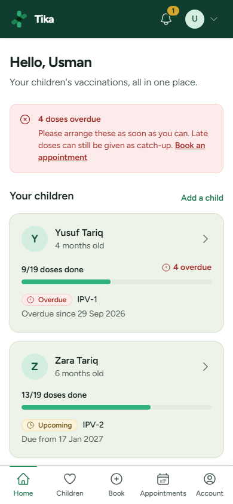 | 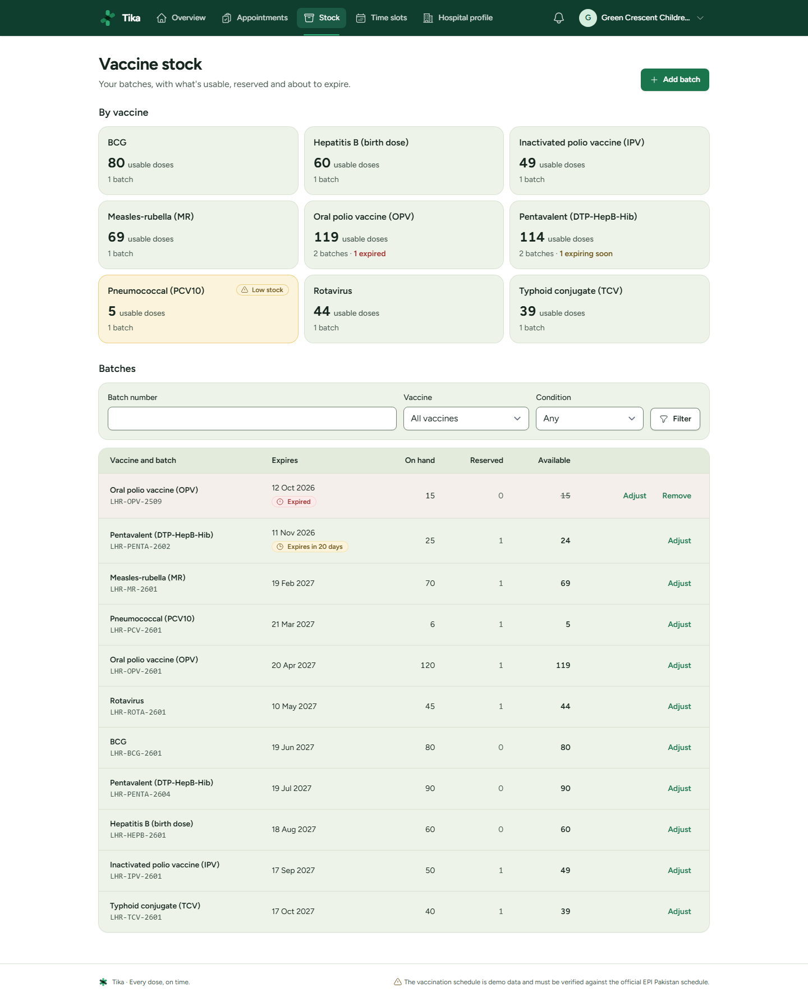 | 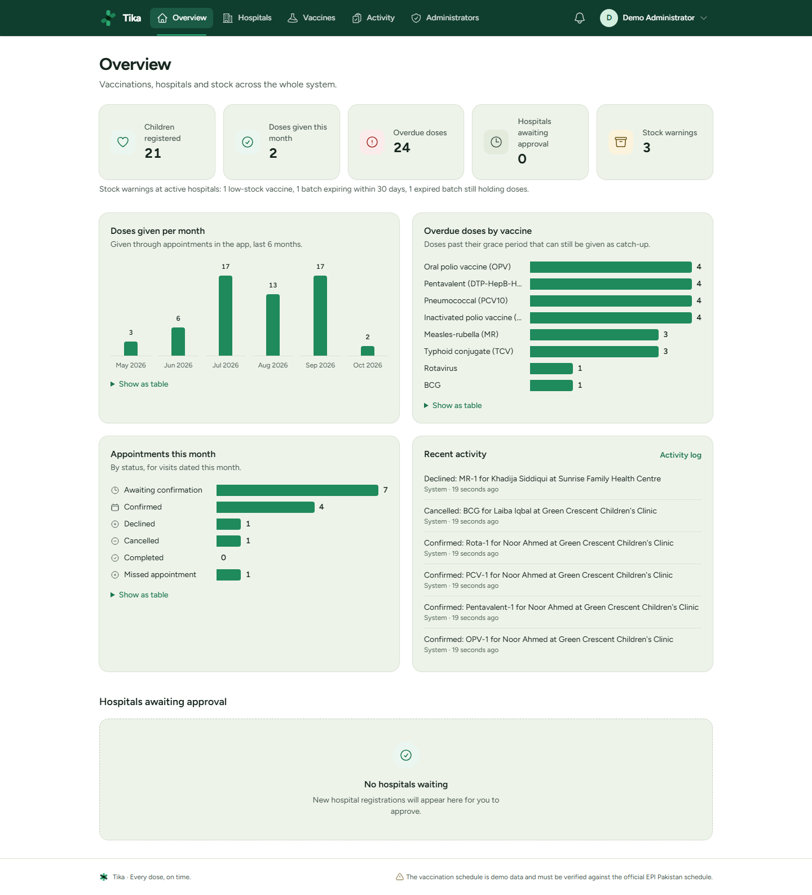 |

## Features

### Parents
- **Children and schedules.** Add a child and every dose is generated from the date of birth.
  Each dose shows as *completed*, *due*, *upcoming*, *overdue* or *missed*, with an icon and a
  plain-language explanation ("Overdue since 3 Mar", "After OPV-1 has been given").
- **Booking in four steps.** Choose the due vaccines (several can share one visit), a hospital
  that has every one of them in stock, a free time, then confirm.
- **Cancel or reschedule** up to 24 hours before. Slots starting within 2 hours aren't offered.
- **Notifications.** Booking confirmed, declined, cancelled or missed; doses due within 7 days;
  overdue doses.
- **Vaccination certificate** per child, printable or as a PDF. Doses copied from an old
  vaccination card are marked "Recorded from previous records".

### Hospitals
- **Self-registration**, then wait for an administrator to approve. Pending and inactive
  hospitals can't log in.
- **Stock batches** with batch number, expiry and quantity. Warnings for low stock, batches
  expiring within 30 days and expired batches still on hand.
- **Time slots**, one at a time or in bulk ("Mon–Sat, 9–1, 30-minute slots, 4 children each,
  for the next month").
- **Appointments**: confirm, decline with a reason, record as given, or mark as missed.
  Earlier doses can be copied from a child's vaccination card.

### Administrators
- **Overview** from live data: children registered, doses given this month, overdue doses,
  hospitals awaiting approval, stock warnings, and charts.
- **Hospitals**: approve, decline, deactivate (which cancels its open appointments and tells
  the parents), reactivate, delete.
- **Vaccine catalog** and a read-only view of the routine schedule.
- **Activity log**: who approved, declined, cancelled, changed or deleted what, searchable.
- **Administrators** are created by another administrator or the seeder, never by sign-up.

Every list has search, filters and pagination.

## How it works

- **Schedule rules** (`app/Services/VaccinationSchedule.php`). A dose's effective due date is
  the later of *date of birth + age* and *previous dose + minimum interval*. Dose N waits for
  dose N−1. Past a vaccine's age limit a dose is *missed*, and so is the rest of that series.
  Vaccines without an age limit are never missed: late doses stay *overdue* and bookable as
  catch-up. Statuses are worked out from dates on every read, never stored.
- **Booking and stock** (`app/Services/AppointmentService.php`). Every action runs in one
  database transaction with row locks (`SELECT … FOR UPDATE`), always taken in the same order.
  Booking reserves a dose from the usable batch that expires soonest (never an expired one);
  declining, cancelling and no-shows release it; completing uses it up. Every check that
  decides something is a locking read, so two people can never take the last dose or the last
  place in a slot. A unique index on a generated column backs up "one open booking per dose"
  in the database itself.
- **Lifecycle**: pending → approved → completed; pending or approved → declined or cancelled;
  approved → missed. Anything else is refused.
- **Scheduled jobs**: hourly, pending bookings whose time has passed are cancelled; daily at
  08:00, parents get due and overdue reminders.

## Tech stack

Laravel 13 · PHP 8.3+ · MySQL or MariaDB · Blade · Tailwind CSS 4 via Vite · Alpine.js ·
Laravel Breeze · Pest · dompdf · Playwright (screenshots only)

## Setup

Requirements: PHP 8.3 or newer (with `pdo_mysql`, `intl`, `zip`, `gd`), Composer 2, Node 20+,
and MySQL 8 or MariaDB 10.4+. On Windows, [Laravel Herd](https://herd.laravel.com) gives you PHP
and Composer; XAMPP's MySQL works for the database.

```bash
composer install
npm install
cp .env.example .env
php artisan key:generate
```

Create two databases, one for the app and one for the tests:

```sql
CREATE DATABASE vaccination_app CHARACTER SET utf8mb4 COLLATE utf8mb4_unicode_ci;
CREATE DATABASE vaccination_app_test CHARACTER SET utf8mb4 COLLATE utf8mb4_unicode_ci;
```

Then load the schema and demo data, build the assets and start the app:

```bash
php artisan migrate --seed
npm run build            # or `npm run dev` while working on the front end
php artisan serve        # http://localhost:8000
```

Run the scheduler in a second terminal so reminders and unconfirmed-booking clean-up happen:

```bash
php artisan schedule:work
```

In production, run `php artisan schedule:run` from cron every minute instead.

### Tests and checks

```bash
php artisan test                   # 300+ feature tests, including row-lock tests on MySQL
php scripts/check-contrast.php     # every colour pair in the palette against WCAG AA
node scripts/screenshots.mjs       # needs `php artisan serve --port=8766`; writes docs/screenshots
```

The tests use the `vaccination_app_test` database (see `phpunit.xml`). They run on MySQL, not
SQLite, because SQLite ignores row locks.

## Test accounts

Every account's password is **`password`**. All data is invented.

| Role | Email | What to look at |
|---|---|---|
| Admin | `admin@test.com` | Overview charts, hospitals, activity log |
| Hospital | `hospital1@test.com` | Low-stock and expired-batch warnings, bookings to confirm |
| Hospital | `hospital2@test.com` | A second active hospital |
| Hospital (inactive) | `hospital3@test.com` | Can't log in |
| Parent | `parent4@test.com` | Yusuf (overdue, missed birth doses) and Zara (missed rotavirus) |
| Parent | `parent1@test.com` | A newborn, and a fully vaccinated two-year-old |
| Parent | `parent2@test.com` | Danyal, two years old with only birth doses: catch-up booking |
| Parent | `parent7@test.com` | Bilal, whose doses were copied from an old vaccination card |

`parent1@test.com` to `parent10@test.com` all exist; between them their 21 children cover every
schedule state.

## Screenshots

All pages at desktop (1440px) and phone (390px) width are in [`docs/screenshots`](docs/screenshots).

| | |
|---|---|
| 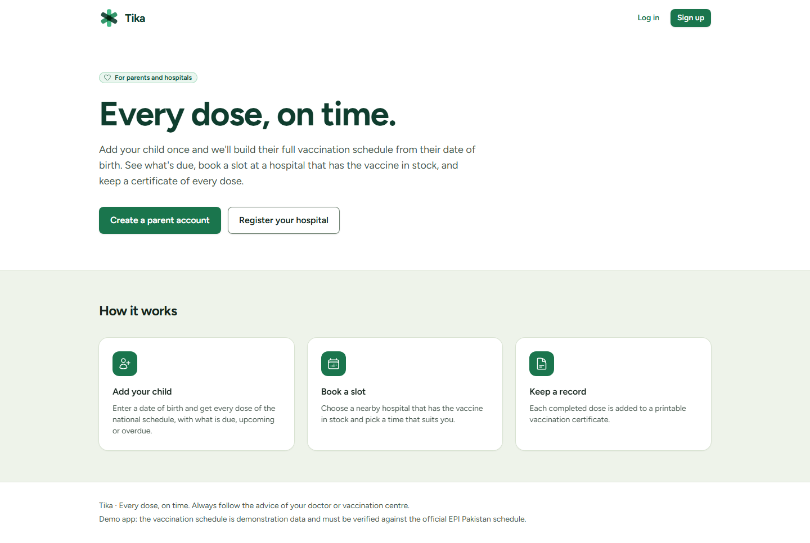 | 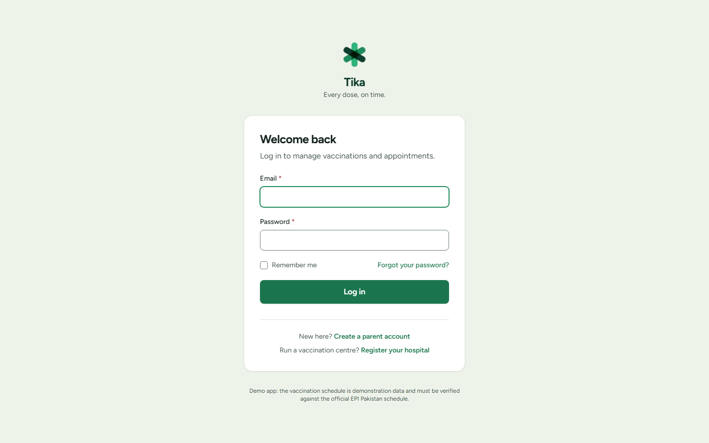 |
| 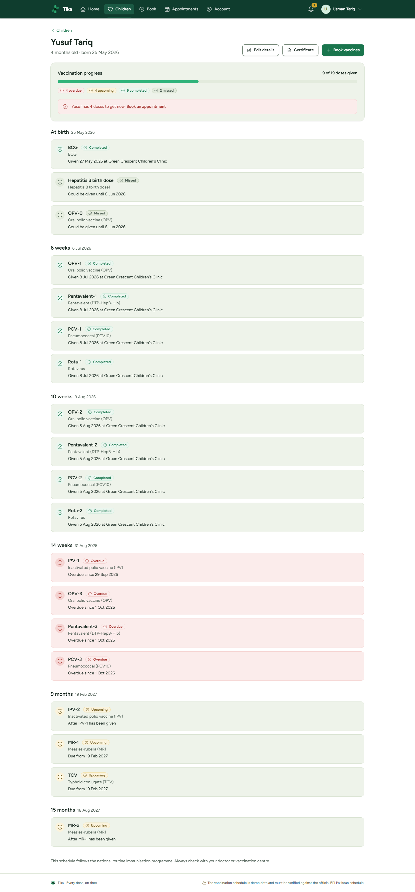 | 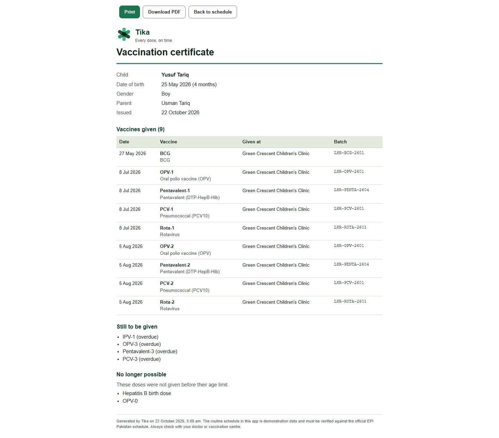 |
| 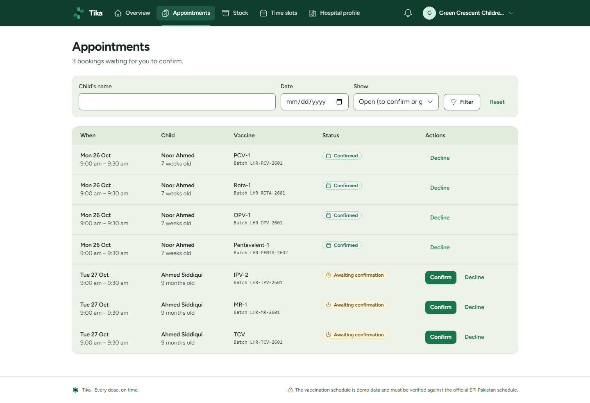 | 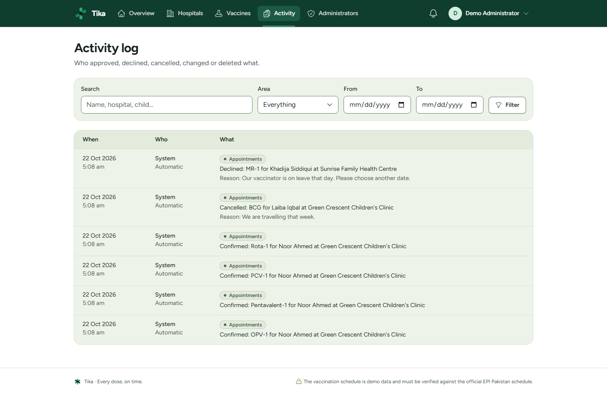 |

| Booking on a phone | | | |
|---|---|---|---|
| 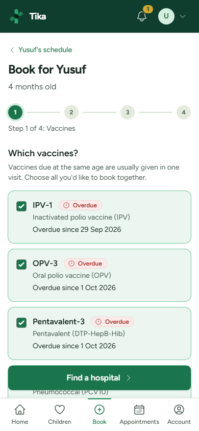 | 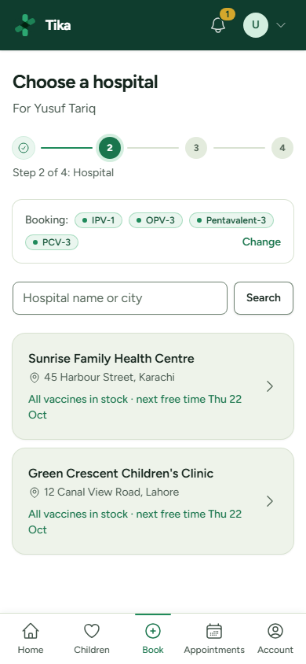 | 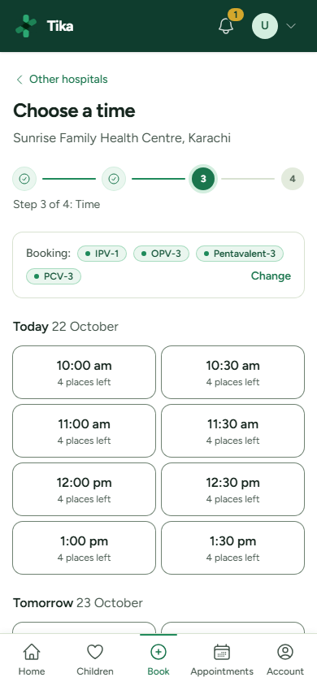 | 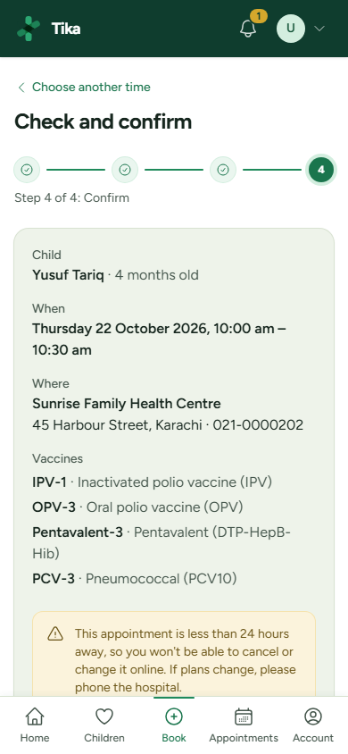 |

## Design

- **Palette** (Tailwind theme tokens in [`resources/css/app.css`](resources/css/app.css)):
  forest `#0F3D2E`, emerald `#1F8A5B`, light emerald `#2FB37A`, sage `#EEF3EA`, mustard
  `#D4A72C`, alert red `#C8352E` (overdue, errors and destructive actions only). Every
  text/background pair passes WCAG AA; see `scripts/check-contrast.php`.
- **Status badges** always pair an icon with a text label: completed (green), due and upcoming
  (mustard), overdue (red), missed (grey).
- **Motion** is subtle and fast (150–250ms ease-out) and switched off for
  `prefers-reduced-motion`, including the logo intro on the log-in page.
- **Logo**: an asterisk of three rounded bars (`<x-logo>`), also the favicon and the loading spinner.

## Rebuilt from a legacy PHP project

Tika is a rebuild of a semester project: a vaccination booking site in plain PHP and MySQL
with two bought-in templates. The original code is kept, untouched, in [`/legacy`](legacy)
for a before/after comparison. A few of the differences:

| Legacy | Tika |
|---|---|
| SQL built by string concatenation (SQL injection everywhere) | Eloquent and bound parameters only |
| Passwords stored in plain text | Bcrypt hashes |
| Log-in checks done with JavaScript redirects | Server-side middleware and policies |
| Deletes on plain GET links | POST/DELETE with CSRF and confirmation dialogs |
| Anyone could register as an administrator | Admins are created only by admins or the seeder |
| Stock as a text column, decremented without a transaction | Integer batches with expiry, reserved under row locks |
| No schedule | Full schedule per child with due, overdue and missed states |
| No tests | 300+ feature tests |

Git history: `046e76a` is the original, `746ff87` adds emergency security fixes to it, and
the rebuild follows phase by phase. Judgement calls made along the way are in
[`DECISIONS.md`](DECISIONS.md).
